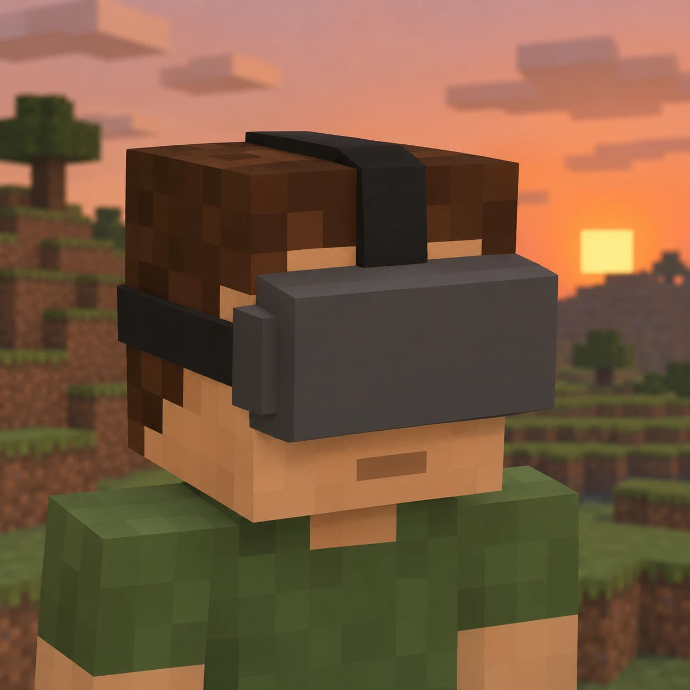

<p align="center"></p>

# Horizon Vivecraft VR

[](https://github.com/v1nx0/horizon-vivecraft-vr/releases/latest)
[](https://github.com/v1nx0/horizon-vivecraft-vr/releases)
[](#donate)
[](#donate)

Play Minecraft 26.3 in VR on the [Horizon](https://github.com/horizon-rust/horizon) client: a port
of [VivecraftMod](https://github.com/Vivecraft/VivecraftMod) using OpenXR (SteamVR, Quest Link).

## Requirements

- Windows 10 or 11 and a VR headset that works with SteamVR.
- Minecraft Java Edition 26.3, played once (in the Horizon launcher or the Minecraft Launcher).
- The Minecraft 26.3 server jar. If the Horizon launcher already downloaded it, it's found
  automatically. Otherwise, download it from minecraft.net.

## Install

1. Download `HorizonVR-Installer.exe` (under 2 MB) from [Releases](https://github.com/v1nx0/horizon-vivecraft-vr/releases/latest) and open it.
2. Check the three paths (install folder, Minecraft folder, server jar) and click **Install**. It downloads the game (about 55 MB).
3. Start SteamVR, then open **Horizon VR** on your desktop.

With the [Horizon launcher](https://github.com/horizon-rust/horizon) installed, the installer also
adds a **Horizon VR** instance to it: start SteamVR, then pick Horizon VR in the launcher and click
Play. It plays with the launcher's Microsoft account. The instance stays on the Horizon nightly the
mod is built on (the launcher downloads it if needed); your other instances are untouched.

Pause menu: hold **Y** on the left controller. A short tap of Y opens the inventory.

When a new version is out, Horizon VR asks when you start it: **Yes** updates now, **No** asks again next time. You can also open **Horizon VR Installer** from the Start menu: it shows when a new version is out, and
**Update** downloads and installs it (the installer updates itself too).

Something broke? Open it and click **Repair**: it reinstalls the game and prepares the
Minecraft files again. **Uninstall** removes Horizon VR and its shortcut, and keeps your worlds and
settings.

## Features

- Roomscale head and hand tracking, snap turn, teleport, and menus shown in front of you.
- Vivecraft's climbing, crawling, swimming, bow and radial menu.
- On servers with the Vivecraft plugin, other players see your VR body, and you see theirs: arms,
  headset, and legs that follow full-body trackers.
- Full-body tracking through OSC (SlimeVR and similar): VR Settings, then **OSC Trackers**.
- Swing your pickaxe or sword to mine and hit (**Weapon Collision**), a VR keyboard for text boxes,
  and a **Comfort Vignette** against motion sickness.
- **Seated Mode** for playing sitting down.
- A **Mods** entry on the ring menu: Fullbright, Zoom, FPS counter and coordinates.

The full list, including what isn't ported, is in [`VR_PORT_STATUS.md`](VR_PORT_STATUS.md).

## Status

Not fully tested in a headset. These have never been tested at all: Vivecraft server networking,
other players' VR bodies, and full-body trackers. Please report bugs in
[Issues](https://github.com/v1nx0/horizon-vivecraft-vr/issues).

## Build from source

You need [Git](https://git-scm.com/download/win), [Rust](https://rustup.rs) and
[JDK 25](https://adoptium.net). Download this repo and run `Install.bat`. It clones Horizon at
commit `6d765e0`, adds the VR code, applies `horizon-hooks.patch`, builds the game and prepares the
game files.

| Path | What it holds |
|---|---|
| `crates/horizon-vr/` | The OpenXR runtime: headset, controllers, eye rendering |
| `horizon-client-vr/vr/` | The game's VR modules (they go in `crates/horizon-client/src/game/vr/`) |
| `horizon-hooks.patch` | The changes to Horizon's own files |
| `installer/` | The installer (`app/`, Rust), `build-release.ps1` (makes the release files), `test-installer.ps1` |

## License

LGPL-3.0, like Vivecraft. See [`LICENSE.md`](LICENSE.md). The ported code credits the Vivecraft
files it comes from.

## Donate

Bitcoin:

```
bc1q0csyzscm725lu4vwf5tsxwg5vr32pgjujtpnh8
```

Solana:

```
HMmUu1qFiWqfHiW5DMvUix5Ai9THvnC6VRwYLRM8zbbs
```
